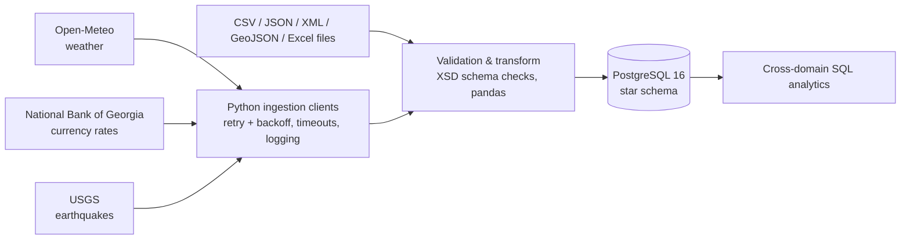

# Enterprise Open Data Platform

A data platform that ingests Georgian public data from three live APIs — weather, currency exchange rates, and earthquakes — validates and normalises it across CSV, JSON, XML, GeoJSON and Excel, and loads it into a PostgreSQL star schema for cross-domain analytics.

Built step by step during a data engineering course, with every stage delivered as a feature branch and pull request.

## Architecture



**Data sources**

| Source | Data | Client |
|---|---|---|
| [Open-Meteo](https://open-meteo.com/) | Hourly weather for Georgian cities | `src/ingestion/weather_client.py` |
| [National Bank of Georgia](https://nbg.gov.ge/) | Daily currency exchange rates | `src/ingestion/currency_client.py` |
| [USGS Earthquake Catalog](https://earthquake.usgs.gov/) | Seismic events inside Georgia's bounding box | `src/ingestion/seismic_client.py` |

**Data model** (details in [`docs/star_schema.md`](docs/star_schema.md))

- Conformed dimensions: `dim_date`, `dim_location`, `dim_currency`
- Fact tables: `fact_weather`, `fact_currency`, `fact_seismic`
- Slowly Changing Dimension Type 2 history on locations (`src/modeling/scd2.py`, unit-tested)

## Tech stack

Python 3.12 · PostgreSQL 16 · Redis 7 · Docker Compose · pandas · requests · tenacity · lxml (XSD validation) · openpyxl · psycopg2 · GitHub Actions

## Features

- **Resilient API clients**: retries with exponential backoff, timeouts and typed errors per source
- **Parallel ingestion**: concurrent fetching with `ThreadPoolExecutor`, benchmarked against sequential
- **Multi-format import engine**: CSV (BOM-safe), JSON, XML with XSD validation, GeoJSON, Excel
- **Dimensional modelling**: star schema with conformed date dimension and SCD Type 2
- **Analytics SQL**: window functions, historical seeding, cross-domain queries (e.g. weather vs. USD rate vs. earthquakes on the same day)
- **Config & logging**: environment-based config via `.env`, structured logging
- **CI**: GitHub Actions check on every pull request

## Getting started

```bash
# 1. Configure environment
cp .env.example .env        # set POSTGRES_DB, POSTGRES_USER, POSTGRES_PASSWORD

# 2. Start PostgreSQL and Redis
docker compose --profile core up -d

# 3. Install dependencies
python -m venv .venv && source .venv/bin/activate
pip install -r requirements.txt

# 4. Create schemas and tables (run the SQL files in lectures/ in numeric order), then e.g.
python lectures/lecture-07-python-basics/run_weather_client.py
python lectures/lecture-08-parallel-processing/parallel_downloader.py
```

## Repository layout

```
src/ingestion/   API clients, retry, config, logging, file import, validation
src/modeling/    SCD Type 2 logic and tests
lectures/        SQL scripts and runnable demos, one folder per course stage
data/sample/     Sample input files in every supported format
data/schemas/    XSD schemas
docs/            Data model documentation
```

## Progress

| Stage | Topic |
|---|---|
| 2 | Docker, Git workflow, CI |
| 3–5 | PostgreSQL schemas, tables, seeding, analytics SQL |
| 6 | Star schema, fact/dimension tables, SCD Type 2 |
| 7 | REST client with config management and logging |
| 8 | Parallel processing |
| 9 | Retry with backoff, multi-source fetch |
| 10 | File formats, XSD validation, pandas transforms |
