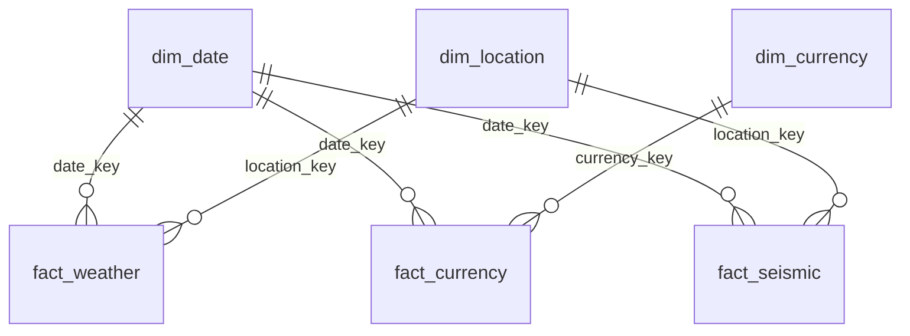

# Star Schema — Enterprise Open Data Platform

## Dimensions (conformed)

| ცხრილი | Surrogate Key | Natural Key | გამოიყენება |
|---|---|---|---|
| dim_date | date_key (INT, YYYYMMDD) | full_date | სამივე fact ცხრილში |
| dim_location | location_key (SERIAL) | city | fact_weather, fact_seismic |
| dim_currency | currency_key (SERIAL) | code | fact_currency |

## Facts

| ცხრილი | Grain (რას წარმოადგენს 1 row) | დაკავშირებული dimension-ები |
|---|---|---|
| fact_weather | 1 ქალაქის 1 საათის ამინდის საზომი | dim_date, dim_location |
| fact_currency | 1 ვალუტის 1 დღის კურსი | dim_date, dim_currency |
| fact_seismic | 1 სეისმური მოვლენა | dim_date, dim_location (nullable) |

## რატომ ეს დიზაინი

`dim_date` არის conformed dimension — სამივე fact ცხრილი მას იზიარებს, რაც
cross-domain ანალიზს (იხ. `009_cross_domain_analysis.sql`) ტრივიალურად ხდის.

`date_key` UTC-ით ითვლება — ETL ტერმინალიდან (UTC სესიით) ეშვება, რომ
თარიღები timezone-ის მიხედვით არ "გადაინაცვლოს".

## ER დიაგრამა

